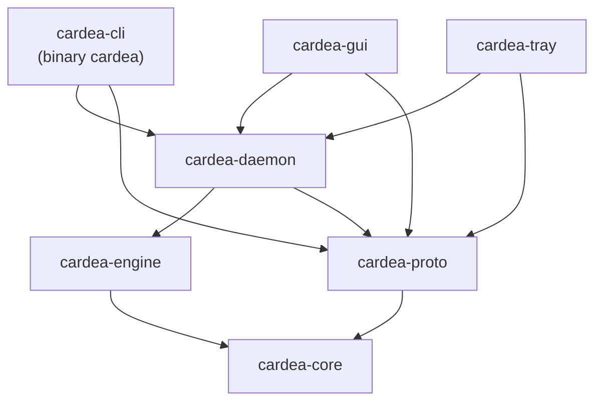
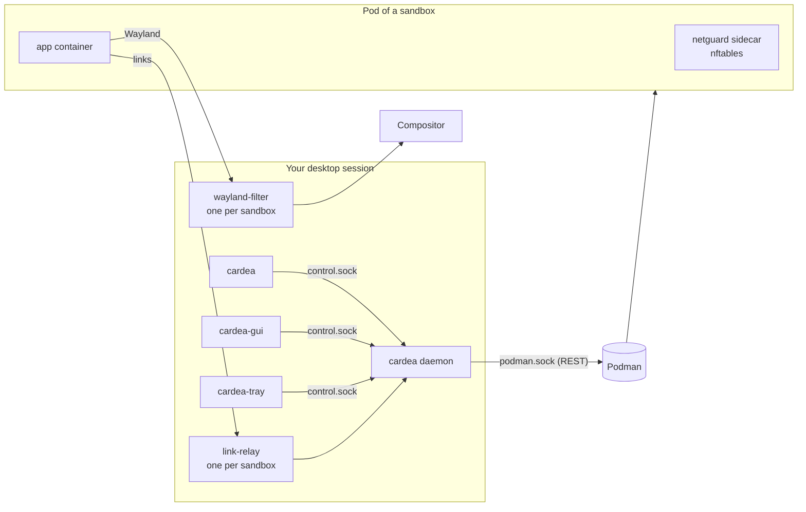
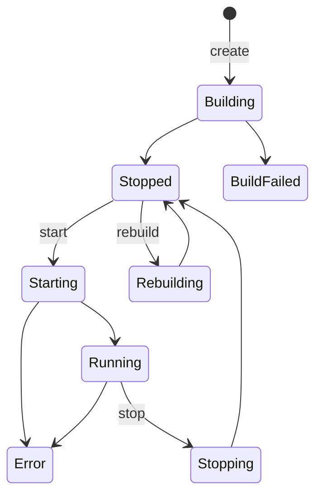

# Architecture

How Cardea is built, for readers of the source code. What each part does for the user is in the other pages.

## Workspace

Cardea is a Rust workspace of seven crates. Three are libraries, one is the daemon, three are clients.

| Crate | Kind | Role |
|---|---|---|
| `cardea-core` | library, pure | Data model, JSON loading and validation, trust presets, risk warnings, Containerfile and container spec generation, nftables rulesets, link checks. No I/O towards Podman. |
| `cardea-proto` | library | The control socket protocol: requests, responses, events. |
| `cardea-engine` | library | What builds, starts and stops sandboxes: the Podman engine and its libpod REST client. |
| `cardea-daemon` | library + `cardea daemon` | The only process that talks to Podman. Owns files, states and tasks; serves the control socket. |
| `cardea-cli` | binary `cardea` | Command line client; also hosts the daemon (`cardea daemon`) and its helper processes. |
| `cardea-gui` | binary `cardea-gui` | The manager window (iced). |
| `cardea-tray` | binary `cardea-tray` | The tray icon (StatusNotifierItem). |

The clients depend on `cardea-daemon` only for shared helpers such as file locations; they never call the engine.

## Processes

| Process | Started by | Job |
|---|---|---|
| `cardea daemon` | systemd user unit `cardea.service` (or a client, when none answers) | State, tasks, Podman, menu entries, the tray's login entry |
| `cardea-gui` | the user, a menu entry, the tray | One window per session: a second launch asks the first one to show itself (`gui.sock`) |
| `cardea-tray` | the login entry the daemon writes | Follows the daemon's events, shows states, sends actions |
| `cardea wayland-filter` | the daemon, per running sandbox | Sits between the sandbox's apps and the compositor; hides the Wayland protocols the sandbox may not use |
| `cardea link-relay` | the daemon, per running sandbox whose links may leave | Carries links from the sandbox to the daemon, which opens them or asks first |
| `cardea-gui --link <id>` | the daemon | Asks whether a link a sandbox sent may open in the browser |

## Control protocol

Clients and daemon exchange one JSON object per line on `$XDG_RUNTIME_DIR/cardea/control.sock` (directory `0700`,
socket `0600`, peer UID checked).

| Direction | Shape |
|---|---|
| Client → daemon | `{"id": 1, "method": "start", "params": {"id": "work"}}` |
| Daemon → client | `{"id": 1, "result": …}` or `{"id": 1, "error": {"code": …, "message": …}}` |
| Daemon → client, after `subscribe` or `logs` with `follow` | `{"event": {"type": …}}` |

The first request is always `hello`, which checks the protocol version. The full list of methods and events is
the `Method` and `Event` enums of `cardea-proto`.

## Daemon

| Module | Content |
|---|---|
| `daemon.rs` | The sandboxes, their lifecycle and tasks, the handling of every request |
| `server.rs` | The control socket and its access check |
| `store.rs` | Files on disk: registry, settings, user profiles, sandbox configs, logs (atomic writes) |
| `paths.rs` | Where every file lives |
| `menu.rs` | Host menu entries of sandbox apps and their icons |
| `wayland.rs` | The Wayland filter |
| `daemon/links.rs` | Incoming and outgoing links |
| `terminal.rs` | Opening a host terminal that runs a `cardea` command |
| `doctor.rs` | The Podman side of `cardea doctor` |

A sandbox does one task at a time. States and the actions each one allows are in `cardea-core/src/state.rs`.

## Engine

The daemon drives an `Engine` trait (`build`, `start`, `stop`, `remove`, `running`, `watch`) and keeps the
states; the engine does the work and reports progress. Its implementation, `PodmanEngine`, runs sandboxes on
rootless Podman through `podman::Client`, a small typed client of the libpod REST API.

A start, in order:

1. `core::image` generates the Containerfile and build context; the engine builds the image when the config needs it.
2. `engine::net` reads the host's gateways, subnets and resolvers; `core::firewall` turns the sandbox's rules into
   an nftables ruleset.
3. `core::spec` builds the pod spec (own user and network namespaces) and the netguard sidecar, which applies the
   ruleset. The app container never starts before the rules are confirmed.
4. `engine::folders` resolves shared folders; protected paths inside read-write folders are re-mounted read-only.
5. `core::spec` builds the app container spec; only what it lists is mounted, never `control.sock` or
   `podman.sock`.
6. The first-start packages and script run in the home; then services and apps.

## Configuration as data

Every app, package, service and setup is data in a profile or a sandbox config; no code path is specific to an
app. All JSON is loaded and checked by `cardea-core` (`load.rs`, `validate.rs`) inside the daemon, every problem
reported at once. Commands are argument arrays, never shell strings built from user values. The formats are
described in [Configuration files](configuration.md).

| Source | Location |
|---|---|
| Built-in profile and package sources | embedded in the binary (`crates/core/builtin/`) |
| Ready-made profiles | repository folder `profiles/` |
| Scripts run inside a sandbox image | `crates/core/guest/` |

## Files on the host

| Path | Content |
|---|---|
| `~/.config/cardea` | Settings and user profiles |
| `~/.local/share/cardea` | Registry and logs |
| `~/Sandboxes/<id>` (default) | A sandbox: `sandbox.json`, `home/`, `state/` |
| `$XDG_RUNTIME_DIR/cardea` | `control.sock`, `gui.sock` |
| `~/.local/share/applications/cardea-<id>-<app>.desktop` | Menu entries of sandbox apps |
| `~/.cache/cardea/icons` | App icons copied out of the sandboxes |
| `~/.config/autostart` | The tray's login entry |

## Manager window

`cardea-gui` follows iced's model: `app.rs` holds the state, the `Message` enum and the updates; `ui/` holds one
view module per page; `conn.rs` keeps one connection to the daemon and turns replies and events into messages.
iced has no keyboard focus on buttons, so `focus.rs` adds a focus layer: each control registers itself while the
view is built and Tab moves along that list. `style.rs` holds the design tokens of the light and dark themes.

## Development

| Command | Does |
|---|---|
| `cargo build --release` | The three binaries |
| `scripts/check.sh` | Formatting, clippy with warnings as errors, tests |
| `scripts/install-dev.sh` | Installs this checkout for the current user (binaries, user unit, menu entry) |
| `scripts/build-deb.sh` | `dist/cardea_<version>_<arch>.deb` |
| `scripts/build-rpm.sh` | `dist/cardea-<version>-1.<arch>.rpm` |
| `scripts/selftest.sh` | End-to-end test on a real install; writes a Markdown report |

Golden files for the generated Containerfiles, specs and rulesets are in `crates/core/tests/golden/`.
