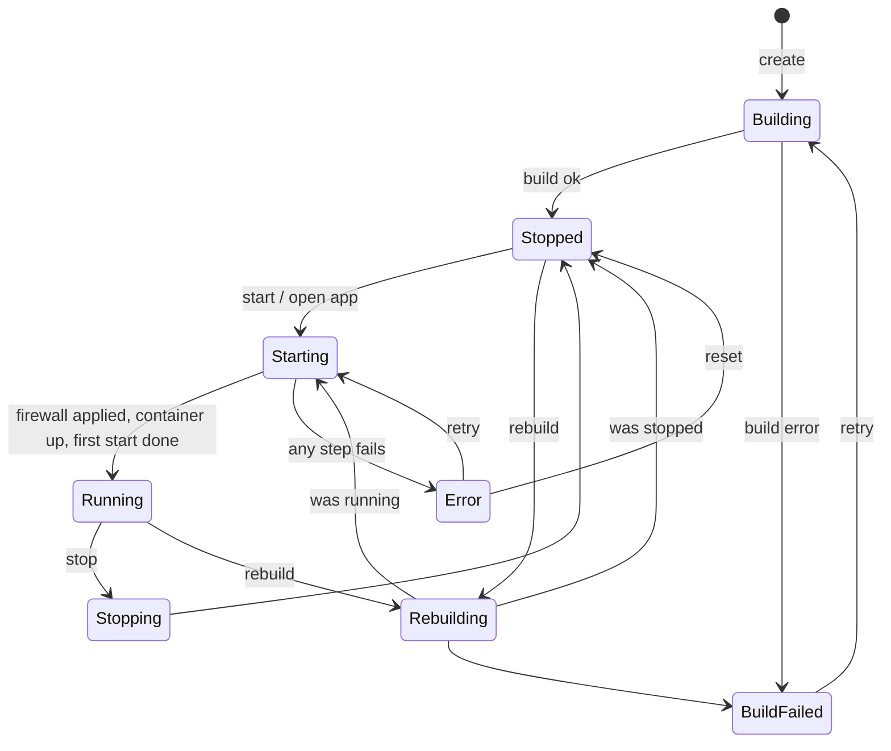

# Concepts

## Sandbox

A sandbox is an isolated environment with:

- an **image**, built for it from a base image (Debian, Fedora, Arch…) plus its packages;
- a **home folder** on your computer, mounted inside as the sandbox user's home; a **disposable** home is instead
  a fresh, empty home at each start, removed when the sandbox stops;
- **shared folders**: folders of your computer made visible inside, read-only or read-write;
- a **firewall** in its own network namespace ([Network firewall](network.md));
- a set of **capabilities**: the access to your desktop and hardware it is granted.

Each sandbox lives in its own folder (by default `~/Sandboxes/<id>/`), with its configuration in `sandbox.json`.

Inside, the sandbox user has your user ID (in a Work sandbox), so files it writes in its home and shared folders
are yours. Its hostname is the sandbox id unless set otherwise, and its machine id is its own, kept in
`state/machine-id`. The image is `localhost/cardea/<id>`; the running sandbox is a Podman pod `cardea-<id>` with
its container `cardea-<id>-app`.

With an **isolated user ID** (the Untrusted preset), a persistent home belongs to that isolated user, not to you:
to remove its files yourself, use `podman unshare rm -rf <folder>`.

## Profile

A profile is a reusable recipe for sandboxes: base image, packages, applications, services, capabilities,
firewall rules. A sandbox created from a profile adds its local settings (name, shared folders, home location).

- A profile never contains a path of your computer, a secret or an IP address (only symbolic network references
  such as "the gateway").
- Before importing a profile, Cardea shows what it asks for and highlights what widens access: GPU, KVM,
  firewall exceptions, third-party package repositories, setup scripts (shown in full).

Built-in profile: **Empty** (a minimal sandbox). Ready-made profiles are JSON files in the repository's
[`profiles/`](../profiles/) folder: download one and import it (`cardea profile import <file>`).

| Profile file | Content |
|---|---|
| `empty-debian.json` | A minimal Debian sandbox: the base image and a shell |
| `claude.json` | Claude Desktop and Claude Code, Firefox, FreeCAD, and development tools: Node, Go, Rust, Python, Java (JDK 21, Maven, Gradle), PHP (with Composer), C# (.NET SDK), C/C++ (with Valgrind), and codeburn (AI token use) |

## Trust level

A trust level is a preset: choosing it sets a group of settings, each of which you can still change. Loosening a
setting of an Untrusted sandbox asks for confirmation and shows a warning.

| | Work | Untrusted |
|---|---|---|
| User ID inside | Your own (files you share keep your ownership) | An isolated, unprivileged ID; at most 15 Untrusted sandboxes run at once with the usual 65536 sub-UIDs (`/etc/subuid`) |
| Home | Persistent | Disposable (fresh at each start), can be made persistent |
| Blocked network traffic | Rejected: programs know at once that it was refused | Dropped: programs only see a timeout |
| Keyring | Unlocked automatically | Off |
| Clipboard | Shared | Off |
| KVM, seccomp off, firewall off, host X11 | Off; allowed after confirmation | Off; allowed after confirmation, with a warning at every start |

## Capabilities

Every access to your desktop or hardware is an explicit capability, off unless the profile or you turn it on.

| Capability | Gives the sandbox |
|---|---|
| Wayland | Windows on your desktop, through a filter of its own (below) |
| Clipboard | With Wayland: **Shared** (copy and paste with your other apps while a sandbox window has the focus) or **Off** (no clipboard between apps, no drag and drop; copy and paste inside one app usually still works) |
| X11 | X11 windows, through a private X server (default) or your desktop's X server (risky). See [Desktop compatibility](desktop-compatibility.md) |
| GPU | Hardware graphics acceleration (`/dev/dri`) |
| Keyring | A secret store for apps (Off, Unlocked automatically, or Asked at each start; can be kept across starts of a disposable sandbox) |
| KVM | Virtual machines inside the sandbox (`/dev/kvm`); risky |

Sandbox apps never reach your desktop's display directly: each running sandbox has a **Wayland filter**, a small
Cardea process between its apps and your desktop. It hides what would let an app watch or drive your other apps,
whatever the settings:

| Hidden | Why |
|---|---|
| Background clipboard access (clipboard managers' protocols) | Reads everything you copy, without the focus |
| Screen capture protocols | Reads your screen |
| Fake input, virtual keyboard and pointer | Types and clicks in your other apps |
| The clipboard, primary selection and drag and drop | Only with **Clipboard: Off** |

An app that asks for a hidden protocol anyway is disconnected. The filter keeps running across a restart of the
Cardea daemon, so windows stay open.

Some apps also need **seccomp** (the system call filter) to be turned off; this is a separate, risky setting.

GPU, keyring and X11 add packages to the image (Mesa, gnome-keyring, xwayland-satellite), so turning them on asks
for a rebuild. Where the distribution has no xwayland-satellite package (Debian 13, Ubuntu), the build compiles a
fixed version of it, which takes a few minutes and the network the first time; the compiler is removed afterwards. A device missing on your computer (`/dev/dri`, `/dev/kvm`) is left out with a line in the log.

With the keyring **asked at each start**, `cardea start` asks for the password in the terminal and the manager in
a small dialog. The password unlocks (or, the first time, creates) the sandbox's login keyring; it is never stored.

## Apps

An app is a program of the sandbox that Cardea can launch: by name from the manager, the tray, the command line
or your desktop's menu (entries named "App (Sandbox)"). Launching an app starts its sandbox if needed.

Cardea adapts the app to Wayland according to its toolkit:

| Toolkit | What Cardea adds |
|---|---|
| Qt | `QT_QPA_PLATFORM=wayland` |
| GTK | `GDK_BACKEND=wayland` |
| Electron | `--ozone-platform=wayland --no-sandbox`, the keyring's password store, `--disable-gpu` without the GPU capability, `--force-dark-mode` with the dark theme |
| Terminal | Opens in a terminal of your desktop |
| X11 | The display of the X11 capability |
| Other | Nothing |

Apps installed in the sandbox are found from their `.desktop` files while it runs, and added in one click with
their icon and window class. An app with a **desktop menu entry** appears in your desktop's menu as "App
(Sandbox)" and groups its windows under that entry in the taskbar. An app from a profile that names no icon or
window class takes them, at its sandbox's first start, from the `.desktop` file of the same program. A window
whose app ID matches the window class of one of the sandbox's menu entries is given that entry's name on its way to
your desktop, so the taskbar shows the app's icon, not Cardea's. Icons are copied
out of the sandbox and converted to PNG.

An app can also open **link schemes** (`claude://`): such a link clicked on your computer opens in it. A sandbox's
apps may send http and https links to your browser when its outgoing links are on. See [Links](links.md).

## Background services

A service is a long-running command kept alive inside a sandbox, without a window: a remote-control agent, a
development server, a notebook server. A service can run once per sandbox or once per shared folder, and can be
started automatically with the sandbox. Its output stays available, and you can attach a terminal to it. If a
service stops unexpectedly, the sandbox shows a warning and its log says so; Cardea does not restart it on its own.

Each instance runs in a tmux session inside the sandbox. Attaching opens it in a terminal; detach with Ctrl+B
then D, and it keeps running.

## Packages and sources

Every package manager is a **source**: the system manager of the base image (apt, dnf, pacman), npm, cargo,
rustup, mise, pipx, or a custom source you describe with a few shell commands. A source installs either into the
**image** (at build time, as root) or into the **home** (in the running sandbox, as the sandbox user). Packages
are installed in list order. Third-party apt repositories require an HTTPS address and the signing key's
fingerprint: a key with another fingerprint stops the build.

| Scope | When it installs | Changing it |
|---|---|---|
| Image (system packages, custom image sources) | At build time, as root | Applies at the next rebuild |
| Home (npm, cargo, rustup, mise, pipx, custom home sources) | In the running sandbox, as you | Applies at once; a stopped sandbox installs it at its next start |

At each start, the home packages that are missing are installed (each source set up first), then the setup
script's **first-start** part runs, once (at every start with a fresh home; a first-start part added later runs at the next start). What fails follows the setup's
failure policy: stop the start, or log it and go on. A package can be limited to a capability ("only with KVM").

The image is rebuilt from cached steps; **Rebuild and update** pulls the base image again and runs every step,
which updates the image's packages and downloads repository keys again (checked against their fingerprint).

The sandbox's languages set its locale (`fr` → `fr_FR.UTF-8`), generated in the image; a dark theme sets
`GTK_THEME=Adwaita:dark`.

## Lifecycle

A sandbox can also show **Restart required** or **Rebuild required** when a setting changes that only applies
after a restart or a new image.
