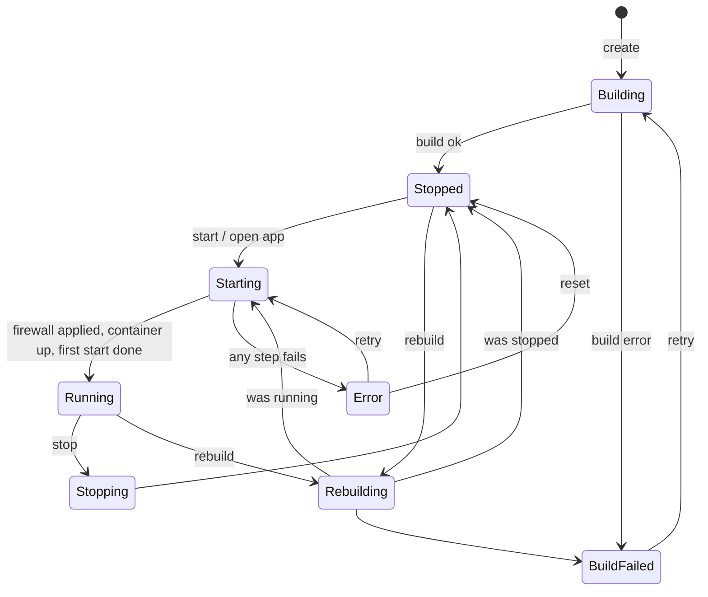

# Concepts

## Sandbox

A sandbox is an isolated environment with:

- an **image**, built for it from a base image (Debian, Fedora, Arch…) plus its packages;
- a **home folder** on your computer, mounted inside as the sandbox user's home (persistent, or wiped at each
  start for a disposable sandbox);
- **shared folders**: folders of your computer made visible inside, read-only or read-write;
- a **firewall** in its own network namespace ([Network firewall](network.md));
- a set of **capabilities**: the access to your desktop and hardware it is granted.

Each sandbox lives in its own folder (by default `~/Sandboxes/<id>/`), with its configuration in `sandbox.json`.

## Profile

A profile is a reusable recipe for sandboxes: base image, packages, applications, services, capabilities,
firewall rules. A sandbox created from a profile adds its local settings (name, shared folders, home location).

- A profile never contains a path of your computer, a secret or an IP address (only symbolic network references
  such as "the gateway").
- Before importing a profile, Cardea shows what it asks for and highlights what widens access: GPU, KVM,
  firewall exceptions, third-party package repositories, setup scripts (shown in full).

Built-in profiles: **Empty** (a minimal sandbox) and **Claude** (Claude Desktop and Claude Code, with common
development tools).

## Trust level

A trust level is a preset: choosing it sets a group of settings, each of which you can still change. Loosening a
setting of an Untrusted sandbox asks for confirmation and shows a warning.

| | Work | Untrusted |
|---|---|---|
| User ID inside | Your own (files you share keep your ownership) | An isolated, unprivileged ID |
| Home | Persistent | Disposable (fresh at each start), can be made persistent |
| Blocked network traffic | Rejected: programs know at once that it was refused | Dropped: programs only see a timeout |
| Keyring | Unlocked automatically | Off |
| KVM, seccomp off, firewall off, host X11 | Off; allowed after confirmation | Off; allowed after confirmation, with a warning at every start |

## Capabilities

Every access to your desktop or hardware is an explicit capability, off unless the profile or you turn it on.

| Capability | Gives the sandbox |
|---|---|
| Wayland | Windows on your desktop |
| X11 | X11 windows, through a private X server (default) or your desktop's X server (risky). See [Desktop compatibility](desktop-compatibility.md) |
| GPU | Hardware graphics acceleration (`/dev/dri`) |
| Keyring | A secret store for apps (Off, Unlocked automatically, or Asked at each start; can be kept across starts of a disposable sandbox) |
| KVM | Virtual machines inside the sandbox (`/dev/kvm`); risky |

Some apps also need **seccomp** (the system call filter) to be turned off; this is a separate, risky setting.

## Apps

An app is a program of the sandbox that Cardea can launch: by name from the manager, the tray, the command line
or your desktop's menu (entries named "App (Sandbox)"). Launching an app starts its sandbox if needed.

Cardea adapts the app to Wayland according to its toolkit (Qt, GTK, Electron, terminal, X11). Apps installed in
the sandbox can be detected from their `.desktop` files, with their icons.

## Background services

A service is a long-running command kept alive inside a sandbox, without a window: a remote-control agent, a
development server, a notebook server. A service can run once per sandbox or once per shared folder, and can be
started automatically with the sandbox. Its output stays available, and you can attach a terminal to it. If a
service stops unexpectedly, Cardea notifies you; it does not restart it on its own.

## Packages and sources

Every package manager is a **source**: the system manager of the base image (apt, dnf, pacman), npm, cargo,
rustup, mise, pipx, or a custom source you describe with a few shell commands. A source installs either into the
**image** (at build time, as root) or into the **home** (in the running sandbox, as the sandbox user). Packages
are installed in list order. Third-party apt repositories require an HTTPS address and the signing key's
fingerprint.

## Lifecycle

A sandbox can also show **Restart required** or **Rebuild required** when a setting changes that only applies
after a restart or a new image.
