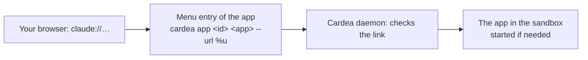
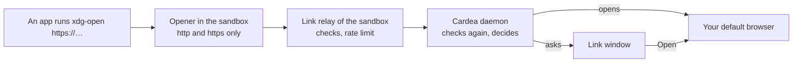

# Links

A link crosses a sandbox's boundary two ways: **incoming**, a link clicked on your computer opens in a sandbox's
app (`claude://…` in Claude Desktop); **outgoing**, a link opened by a sandbox's app opens in your default
browser. Both are off unless a profile or you turn them on.

## Incoming links

An app opens the link schemes listed in its `schemes` (in `sandbox.json` or the profile):

```json
{ "id": "claude-desktop", "name": "Claude", "exec": ["claude-desktop"], "toolkit": "electron",
  "schemes": ["claude"] }
```



- The app gets a menu entry that declares its schemes (hidden from the menu when the app has no menu entry of its
  own).
- The link reaches the app as its last argument, never mixed with other arguments. It must start with one of the
  app's schemes, be at most 4 KiB, have no control character, and be a valid address; otherwise it is refused.
- A stopped sandbox is started first, as when you open the app from the menu.
- Browser schemes (`http`, `https`, `file`…) can never be claimed.

**Who opens a scheme** is your desktop's choice. Cardea makes the sandbox's app the default handler only when no
app handles the scheme yet. When an app of your computer, or another sandbox, already handles it, Cardea changes
nothing and says so on the Links page and in `cardea links`; to change it, use your desktop's default apps
settings. Removing the app, its scheme or the sandbox removes its menu entry, and a default handler that still
names that entry is reset.

## Outgoing links



| Setting (`links` in `sandbox.json`) | Default | Effect |
|---|---|---|
| `outgoing` | `false` | Links may leave the sandbox. Applies at the next start |
| `ask` | `true` | Ask before opening each link. An Untrusted sandbox always asks |
| `allowed` | `[]` | Hosts opened without asking, exact names: `github.com` does not cover `gist.github.com`, and it applies to this sandbox only. Ignored in an Untrusted sandbox |

When `outgoing` is on, the sandbox's `xdg-open` (and `BROWSER`) is Cardea's opener. It refuses anything but
`http://` and `https://` links in the sandbox already. Each link is then checked again outside the sandbox: valid
address, at most 4 KiB, no control character, http or https only. At most one link every 3 seconds goes through,
and while a link waits for your answer, others are dropped. What is dropped and why is written to the sandbox's
`state/links.log`; what is opened, cancelled or refused goes to its log.

| Case | Result |
|---|---|
| `outgoing` off | Refused |
| Untrusted sandbox | Asks, in a red window, without the "Always" boxes |
| Suspicious link (below) | Asks, saying why, without "Always for this domain" |
| `ask` off, or the host is allowed | Opens |
| Otherwise | Asks |

A link is **suspicious** when:

| What | The window says |
|---|---|
| A name before the domain (`github.com@evil.com`) | The real domain is **evil.com** |
| A domain in non-Latin letters | It may imitate another one, with its `xn--…` form |
| A bare IP address | The link goes to an IP address, not a domain |
| Your computer or local network (`localhost`, private addresses, `.local`, a name without a dot) | Said plainly; such links are allowed, after your click |
| A port other than the usual one | The port, such as **8443** |
| More than 2 000 characters | Data may be hidden in it |

## The link window

When a link needs your answer, a window of its own opens, whether the manager is open or not:

- the sandbox's name and the full link, with its domain in **bold**, and the reasons it is suspicious;
- **Always for this sandbox**: stop asking for its links (sets `ask` off);
- **Always for &lt;domain&gt; in this sandbox**: add the domain to its allowed hosts;
- **Open** and **Cancel**.

Both boxes start unticked. **Open** stays disabled for one second after the window shows, and no key opens a
link: a click does. Escape cancels. Closing the window cancels. A link not answered within 2 minutes is dropped.
An Untrusted sandbox's window is red and has no box.

## Links page and command

The sandbox's **Links** page shows each scheme with its app and who opens it (this sandbox, an app of your
computer, another sandbox), then the outgoing links: on or off, asking, and the allowed hosts with **Remove** and
**Add**.

| Command | What it does |
|---|---|
| `cardea links <id>` | The schemes and who opens them, and the outgoing link settings |
| `cardea links <id> outgoing on\|off` | Let the sandbox's links go to your browser, or not (at the next start) |
| `cardea links <id> ask on\|off` | Ask before opening each link, or not |
| `cardea links <id> allow <host>` | Open this host's links without asking |
| `cardea links <id> forget <host>` | Ask again for this host |
| `cardea app <id> <app> --url <link>` | Open a link in the app (what its menu entry runs) |

## Sign-ins that come back to localhost

Some command-line tools sign in through your browser, then wait for the browser to come back to
`http://localhost:<port>` **inside the sandbox**. Your browser runs on your computer, where that address leads
nowhere, so this return fails. Use the tool's way without the return instead:

| Tool | Sign-in that works from a sandbox |
|---|---|
| Claude Code | Open the address it prints under "Browser didn't open?": the page shows a code, paste it into Claude Code |
| Any tool | Paste the sign-in address into a browser **inside** the sandbox (Firefox in the Claude profile): its return to `localhost` stays in the sandbox |
