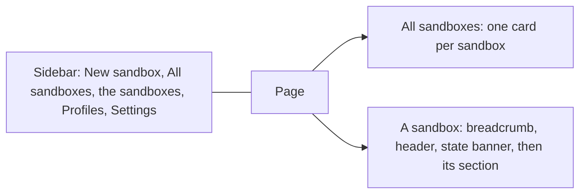

# The manager window

`cardea-gui` opens the manager window. It is a client of the daemon, like the `cardea` command: when no daemon
answers, it starts one. If the connection is lost, the window says so and reconnects by itself.

## Starting it

| Command | What it does |
|---|---|
| `cardea-gui` | Open the window, or bring the open one to the front: only one window runs at a time |
| `cardea-gui --theme light` / `--theme dark` | Ignore the desktop's light / dark preference |

By default the window follows the desktop's light / dark preference and switches when it changes.

To get the Cardea icon on the window and in the menus, run `scripts/install-desktop.sh` once: it installs
`cardea.desktop` and the icon in `~/.local/share` (no root needed). On Wayland, desktops take a window's icon
from the desktop entry that matches its app id, `cardea`.

## Layout

| Part | Content |
|---|---|
| Sidebar | Every sandbox with its state; the open sandbox expands into its sections |
| All sandboxes | Search, filter (All, Running, Stopped, Needs attention), one card per sandbox with its state, trust level, warnings, CPU / RAM of the last seconds, progress of a running task, and its actions |
| Sandbox header | Name, state, trust level, warnings, and the actions the state allows: Start, Stop, Restart, Retry build, Delete |
| State banner | Progress of a build, start or stop; why a sandbox is in error; a restart or rebuild that is required, with its button |
| Overview | CPU and RAM of the last minute, pinned apps, the main settings at a glance, the five last log lines |
| Log | The sandbox log, live, with a text filter and Copy |

When no sandbox exists, the page offers to create one from each profile. When the daemon cannot run sandboxes
(no engine), a red banner says why, with **Check again**.

## Stopping and deleting

| Dialog | Choices |
|---|---|
| Stop | Stop or Cancel. Apps open in the sandbox are closed; files in its home and shared folders are kept |
| Delete | **Keep its folder** (the default: the sandbox leaves the list, its folder stays and can be reused) or **Also delete its folder and home** (permanent). Shared folders are never touched. Only a stopped sandbox, or one in error, can be deleted |

## Keyboard

Everything in the window can be used without the mouse. The focused control has an accent ring.

| Key | Action |
|---|---|
| Tab / Shift+Tab | Next / previous control |
| ↑ ↓ ← → | Previous / next control in the same area (sidebar or page) |
| F6 | Jump between the sidebar and the page |
| Enter or Space | Activate the focused control |
| Escape | Close the dialog; otherwise dismiss the error banner; otherwise back to All sandboxes |
| Ctrl+F | Search the sandboxes (All sandboxes) or filter the log (Log) |
| Ctrl+L | Log of the open sandbox |
| Ctrl+N | New sandbox |
| Ctrl+Q | Quit |

While a dialog is open, the focus stays inside it.
