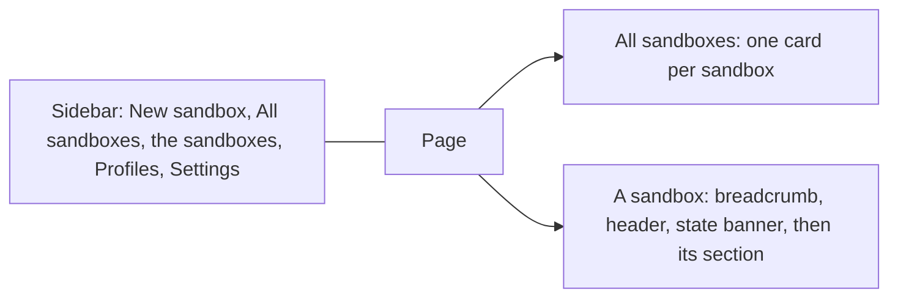

# The manager window

`cardea-gui` opens the manager window. It is a client of the daemon, like the `cardea` command: when no daemon
answers, it starts one. If the connection is lost, the window says so and reconnects by itself.

## Starting it

| Command | What it does |
|---|---|
| `cardea-gui` | Open the window, or bring the open one to the front: only one window runs at a time |
| `cardea-gui --theme light` / `--theme dark` | Ignore the desktop's light / dark preference |
| `cardea-gui --link <request>` | The link window, opened by the daemon when a sandbox's link needs your answer ([Links](links.md)); it runs beside the manager |

By default the window follows the desktop's light / dark preference and switches when it changes, unless the
Settings page sets Light or Dark.

The window and menus show the Cardea icon through the desktop entry `cardea.desktop`, installed by the package
(see [Installation](install.md)). On Wayland, desktops take a window's icon from the desktop entry that matches
its app id, `cardea`.

## Layout

| Part | Content |
|---|---|
| Sidebar | Every sandbox with its state; the open sandbox expands into its sections |
| All sandboxes | Search, filter (All, Running, Stopped, Needs attention), one card per sandbox with its state, trust level, warnings, CPU / RAM of the last seconds, progress of a running task, and its actions |
| Sandbox header | Name, state, trust level, warnings, and the actions the state allows: Start, Stop, Restart, Retry build, Delete |
| State banner | Progress of a build, start or stop; why a sandbox is in error; a restart or rebuild that is required, with its button |
| Overview | CPU and RAM of the last minute, pinned apps (select one to open it), the main settings at a glance, the five last log lines |
| Apps | The apps: order (↑ ↓), interface type (select it to change), pinned, desktop menu entry, **Open**, Remove; a banner when an app requests a capability that is off, with a button to turn it on. **Found in the sandbox**: the installed apps, added in one click. **Background services**: each instance with its state, Start / Restart, Stop, **Attach** (in a terminal) and "At start" |
| Security & capabilities | The trust level (Work or Untrusted: a preset), seccomp, isolated user ID, fresh home at each start, the firewall's state; the capabilities with the apps that request them: Wayland, clipboard (Shared, Off), GPU, keyring (Off, Unlocked automatically, Ask at each start, and Keep across starts with a fresh home), KVM, X11 (Off, Isolated, Host) |
| Packages | Tabs: **Installed** (each package with its source, where it installs, its status in the running sandbox, Update and Remove), **Add package** (source, name, version), **Add apt repository** (name, URL, suite, components, key URL, required fingerprint; the repositories with Remove), **Sources** (built-in and custom, scope, number of packages). **Update home packages** and **Rebuild and update the image** |
| Image & setup | The base image (Debian 13 or 12, Ubuntu 24.04, Fedora 42, Arch Linux, or any image), the setup script's build and first-start parts (edited with `cardea edit`), the failure policy, **Rebuild image** and **Rebuild and update** |
| Shared folders | The shared folders: path on your computer, path in the sandbox, access (select it to switch between read-only and read-write), found or missing, Remove. **+ Add folder…** opens a card: the folder on your computer (`~/` allowed), where it appears (`/work/<name>`, the same path, or another path), its access. Below, the protected paths: select one to remove it, type a name and **+ Add** |
| Network | The firewall: on or off, what the references resolve to, Reject or Drop, then each zone (Host, Local network, Internet) with its Allowlist / Blocklist mode, its blocked count, its entries (✕ removes one) and **+ Add** (destination, port, protocol, comment); below, the recently blocked connections with **Allow** (or **Unblock** in a blocklist zone). Changes apply at once |
| Links | **Incoming links**: each scheme with its app and who opens it (this sandbox, an app of your computer, another sandbox). **Outgoing links**: on or off (at the next start), ask before opening (always for an Untrusted sandbox), the hosts opened without asking with **Remove**, and a field with **Add**. See [Links](links.md) |
| Log | The sandbox log, live, with a text filter and Copy |
| Advanced | Where the sandbox and its home are, with their size and **Open**; RAM limit and app languages (**Save**); app theme; start at login; **Duplicate as** a new sandbox; **Save as profile**; **Export** its `sandbox.json` to a file; **Delete sandbox…** |

When no sandbox exists, the page offers to create one from each profile, and checks your computer (session type,
with the ways out of an X11 session; tray host; Podman, its version, sub-UIDs, passt), with what to do for each
missing piece. When the daemon cannot run sandboxes
(no engine), a red banner says why, with **Check again**.

## Creating a sandbox

**New sandbox** (or Ctrl+N, or **Create sandbox** on a profile) opens an 8-step wizard; Back and Next move between
steps, everything works from the keyboard.

| Step | What you choose |
|---|---|
| 1 · Profile | The recipe; its summary shows what it sets up. **Import a profile…** is here too |
| 2 · Base image | Debian 13 or 12, Ubuntu 24.04, Fedora 42, Arch, or any image reference. A profile with apt repositories needs Debian or Ubuntu |
| 3 · Name & location | The name (made unique), the icon colour, the folder that holds the sandbox's folder |
| 4 · Trust | Work or Untrusted (a preset: everything stays editable) |
| 5 · Folders | Optional shared folders (read-only by default when Untrusted) |
| 6 · Setup script | Optional extra commands, at build (root) and at first start (you), after the profile's own |
| 7 · Summary | Everything chosen; **Create** |
| 8 · Build | The build's progress and last log lines; **Open the sandbox** |

## Profiles and settings

| Page | Content |
|---|---|
| Profiles | Built-in profiles and yours: base image, packages, apps, the sandboxes made from it; **Create sandbox**, **View**, **Delete** (yours) |
| A profile | What it asks for, the items that widen access marked `!` (setup script and custom sources in full, capabilities, a loosened firewall, apt repositories, the Work trust level, a base image outside the standard list); **Export to this file** |
| Import a profile | A file path and **Read**: the same review, then **Import** |
| Settings | Tray icon at login; sandboxes started at login; location for new sandboxes and each sandbox's folder and size; tool theme; terminal command; the requirements check with **Copy report** |

## Stopping and deleting

| Dialog | Choices |
|---|---|
| Stop | Stop or Cancel. Apps open in the sandbox are closed; files in its home and shared folders are kept |
| Delete | **Keep its folder** (the default: the sandbox leaves the list, its folder stays and can be reused) or **Also delete its folder and home** (permanent). Shared folders are never touched. Only a stopped sandbox, or one in error, can be deleted |

## Risky settings

Turning the firewall off, switching the Host or Local network zone to a blocklist, or turning on a risky setting
(KVM, seccomp off, the host's X server, your own user ID or a persistent home in an Untrusted sandbox) opens a
dialog that says what it exposes; for the host's X server it also shows how to run the app on Wayland first. Its button stays disabled until **I understand the risk** is ticked. Once confirmed, the
setting is flagged with a warning on the sandbox's card, its header and its Network page.

## Keyring password

Starting a sandbox whose keyring asks for its password, from a button or by opening an app, shows a password
dialog. The password goes to the sandbox's keyring only.

## Keyboard

Everything in the window can be used without the mouse. The focused control has an accent ring.

| Key | Action |
|---|---|
| Tab / Shift+Tab | Next / previous control |
| ↑ ↓ ← → | Previous / next control in the same area (sidebar or page) |
| F6 | Jump between the sidebar and the page |
| Enter or Space | Activate the focused control |
| Escape | Close the dialog; otherwise dismiss the error banner; otherwise back to All sandboxes |
| Ctrl+F | Search the sandboxes (All sandboxes) or filter the log (Log) |
| Ctrl+L | Log of the open sandbox |
| Ctrl+N | New sandbox |
| Ctrl+Q | Quit |

While a dialog is open, the focus stays inside it.
