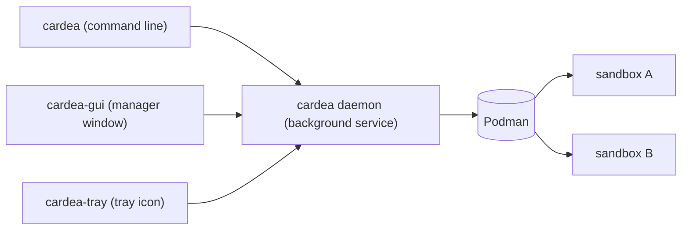

# Overview

## What Cardea does

- Keeps a **library of sandboxes**. Each one is an isolated environment for a set of applications: an AI coding
  agent, a CAD tool, a browser for untrusted sites, a test of an unknown program.
- Builds each sandbox from a **profile**: a declarative description of the base image, packages, applications,
  shared folders and permissions. Profiles can be shared; they never contain host paths or secrets.
- Shows sandbox applications as **normal windows** on your desktop (Wayland), with their own menu entries.
- Filters each sandbox's **network traffic** with its own firewall, on by default.
- Is driven from a **graphical manager**, a **tray icon** or a **command line**.

Nothing in Cardea is specific to one application: every application is described by data in a profile.

## Components

| Component | Role |
|---|---|
| `cardea daemon` | Background service (systemd user unit). The only part that talks to Podman. Keeps the sandboxes' state, runs builds and starts, applies firewall rules. |
| `cardea-gui` | The manager window: create, configure and monitor sandboxes. |
| `cardea-tray` | Tray icon: sandbox states, quick start / stop, launch apps, notifications. |
| `cardea` | Command line client, with the same features as the manager. |

The clients talk to the daemon through a private socket readable only by your user. Neither this socket nor
Podman's is ever made visible inside a sandbox.

## Requirements

| Requirement | Why |
|---|---|
| Linux with a **Wayland** desktop session (KDE Plasma, GNOME, Cinnamon…) | Sandbox windows are shown through Wayland. See [Desktop compatibility](desktop-compatibility.md). |
| **Podman** 4.4 or later, rootless, with `passt` and `catatonit` | Runs the sandboxes without root. |
| The `podman.socket` user unit enabled | The daemon talks to Podman through its API. |
| Sub-UID and sub-GID ranges for your user (`/etc/subuid`, `/etc/subgid`) | Needed by rootless Podman and by isolated user IDs. |

Cardea never needs root and never changes your system firewall.
